# LBA2 Twinsen Mods: mundo aberto, espaço e muito mais

**[Português](#português) · [English](#english)**

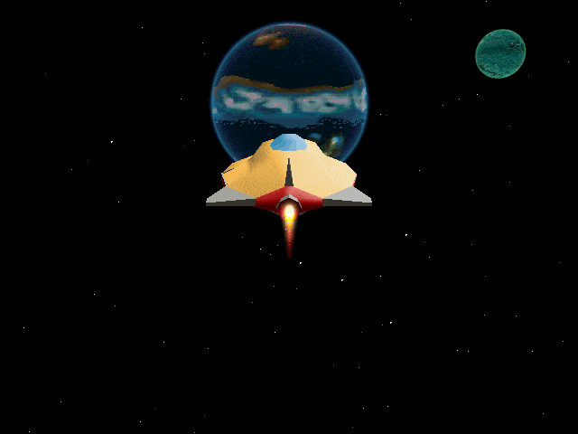

---

## Português

Um pacote de mods para **Little Big Adventure 2 (Twinsen's Odyssey)**. Ele transforma o jogo de 1997 num mundo aberto: dá para nadar, voar e pilotar de uma ilha para outra sem telas de carregamento, subir com a nave até o espaço e viajar entre Twinsun, a Lua Esmeralda e Zeelich.

Tudo vem com um **Gerenciador de Mods** simples, em português e em inglês, para ligar e desligar cada mod.

> Você precisa ter o jogo original (testado na versão **GOG**, *Little Big Adventure 2 Classic*). Este pacote **não traz nenhum arquivo do jogo**: imagens, sons e textos são lidos da sua própria cópia na hora em que você joga.

### O que tem de novo

#### Mundo Aberto: um mapa por planeta
- As ilhas de cada planeta viram **um mapa contínuo**: as de Twinsun, as de Zeelich e as do mundo sob o gás.
- Siga além da borda de uma ilha, nadando, de jetpack ou pilotando, e você chega ao **mar aberto** e às outras ilhas, sem tela de carregamento entre as áreas de mar.
- **Mini holomapa** no canto da tela, no estilo do inventário. Ele mostra onde o Twinsen está e o **nome do lugar** ("Ilha da Fortaleza", "Mar aberto"…).
- **Distância de visão maior**: o litoral e as ilhas aparecem de mais longe.

#### Espaço: viaje entre os mundos
- Suba bem alto com a **nave dos Esmers** e você entra num **espaço feito do zero**, com céu estrelado e os dois sóis de Twinsun.
- Os três mundos aparecem como esferas, usando **as próprias imagens dos planetas do holomapa** do jogo.
- Pilote até um deles: ao chegar perto, o jogo carrega a ilha mais próxima de onde você chegou e você desce voando.
- No espaço não há barulho de motor (é vácuo) e toca a música da Lua Esmeralda.

#### Pilotar naves e veículos
- Chegue perto de **qualquer nave ou veículo** e aperte **V** para entrar: nave Esmer, táxi de Otringal, balsa, balão e até o **Dino-Fly**.
- As **naves** sobem e descem (E/Q) e inclinam nas curvas. **Barcos e o balão** ficam na água, com física de barco no estilo **GTA**.
- **Detalhes que dão vida:**
  - a nave recolhe o **trem de pouso** ao decolar e baixa ao pousar;
  - as **portas fecham** quando você entra e abrem quando sai;
  - a **hélice do balão** gira;
  - a nave acende as **luzes originais do jogo** (as mesmas da nave que sai da base em Otringal);
  - ela solta **fogo pelo escapamento** ao acelerar, como no vídeo do jogo;
  - parada no ar, a nave **flutua** subindo e descendo devagar.
- **Sons:** a decolagem, o pouso e o motor dos barcos são os do próprio jogo. O som de voo da nave é tirado **do vídeo original do jogo**, na hora em que você joga. O Dino-Fly bate as asas e tem limite de altura.

#### Câmera Orbital (estilo GTA)
- A câmera segue o Twinsen e **se ajeita sozinha** atrás dele.
- O **mouse gira livre**, sem segurar botão, e volta depois de um instante. A roda do mouse dá zoom.
- Voando alto, dá para olhar **de baixo para cima**.

#### Natação
- O Twinsen **nada** em toda água funda e até no **gás de Zeelich**, em vez de se afogar. No modo Atlético ele nada mais rápido.

#### Jetpack livre
- Com o Super Jetpack: **E** sobe e **Q** desce. Ele paira no ar, sem limite de altura e sem paredes invisíveis.

#### Mundo Aberto: liberar pela história (adicional opcional)
- Para quem quer o mundo aberto **sem pular a história**: as ilhas e os planetas só abrem conforme você avança no jogo.
- Uma ilha ainda não alcançada fica coberta por uma **cúpula transparente**. Ela aparece quando você chega perto, com o aviso **"Avance a história para liberar"**, e não deixa passar.
- No espaço, o planeta bloqueado fica envolto numa **camada branca**, com o aviso no meio dele.

#### Gerenciador de Mods
- Liga e desliga cada mod com **um número**.
- **Português ou inglês** (tecla L): troca o idioma do gerenciador, das descrições, dos textos que os mods mostram no jogo e do próprio jogo.
- Os mods rodam na versão da comunidade do jogo: **os arquivos originais não são mudados**, e a tecla O continua abrindo o jogo original da GOG.

### O que tem de inovador
- **Um jogo de 1997 com mundo aberto de verdade.** As ilhas de cada planeta foram costuradas num mapa só, e o mar entre elas é atravessado sem tela de carregamento.
- **Uma camada de espaço feita do zero.** Ela usa as texturas originais do holomapa para desenhar os planetas como esferas e liga os três mundos pelo voo.
- **Só arquivos do próprio jogo.** O pacote não redistribui nada do jogo:
  - o som de voo da nave sai do vídeo original;
  - as luzes da nave são as do modelo original;
  - os nomes das ilhas vêm dos textos do holomapa, no idioma do jogo.
- **Tudo é opcional.** Cada mod liga e desliga separadamente, e o jogo original da GOG continua intacto e jogável (tecla O).

### Galeria

| | |
|---|---|
| 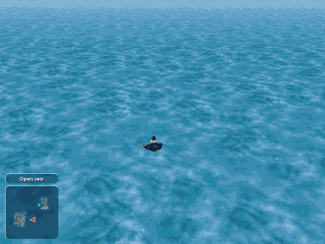 Nadando no mar aberto, com o mini holomapa | 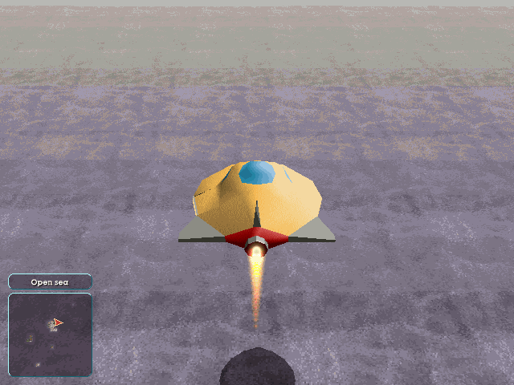 Nave Esmer acelerando |
| 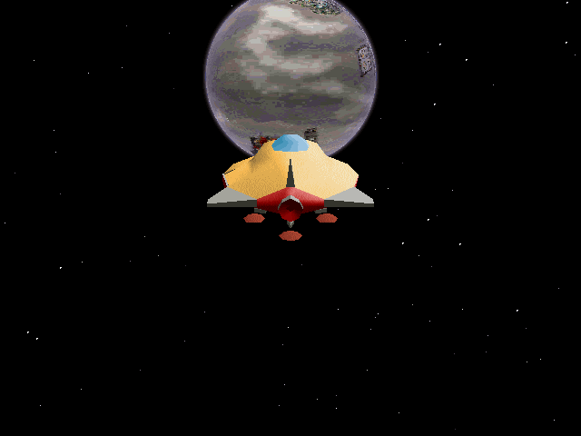 No espaço, indo para Zeelich | 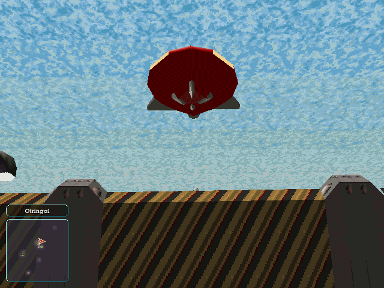 Câmera olhando de baixo para cima |
| 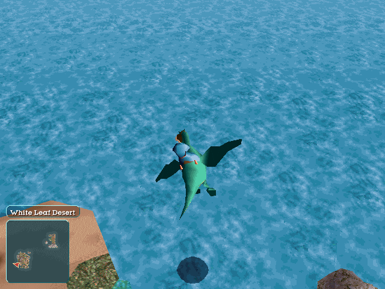 Montado no Dino-Fly | 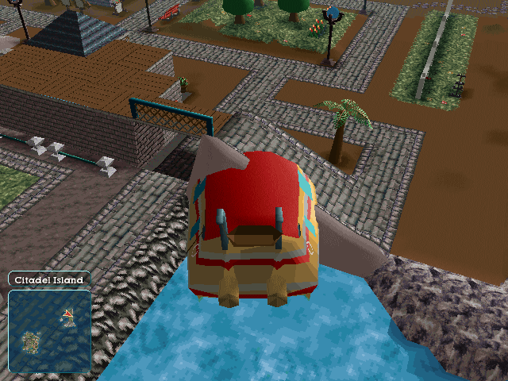 Pilotando a balsa |
| 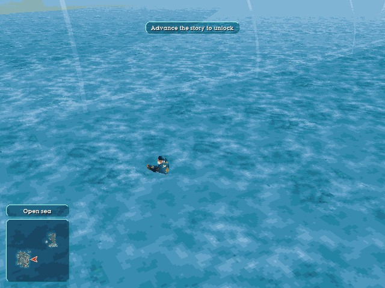 Modo história: cúpula da ilha bloqueada | 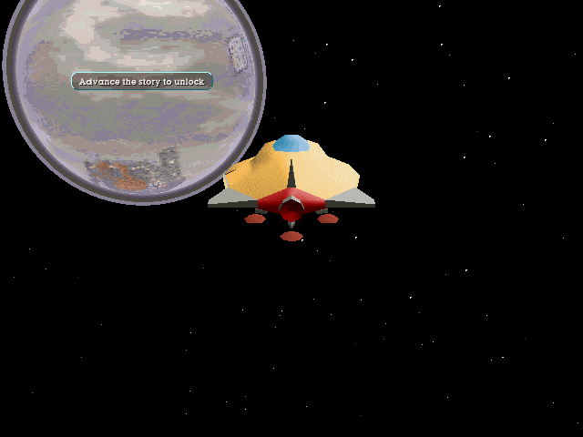 Modo história: planeta bloqueado |

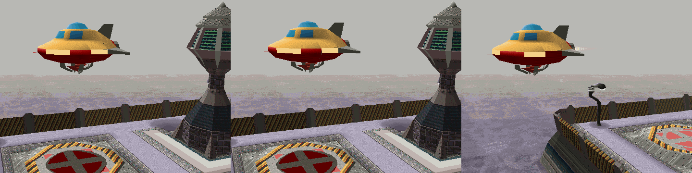
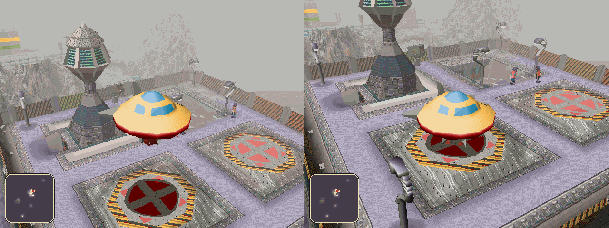

### Requisitos
- Windows 10 ou 11, 64 bits.
- *Little Big Adventure 2* original. Testado na versão **GOG** (*Little Big Adventure 2 Classic*). Outras versões com a mesma pasta `Common` devem funcionar, mas não foram testadas.

### Como baixar
1. Vá em **[Releases](../../releases)**, nesta página do GitHub.
2. Baixe o arquivo **`LBA2-Twinsen-Mods-vX.Y.zip`** da versão mais recente. Não use o "Source code": ele vem sem o programa do jogo.

### Como instalar
1. Abra a pasta do jogo: é a pasta que tem a pasta **`Common`** e o `TLBA2C.exe`. Na GOG, por exemplo:
   `C:\Program Files\GOG Galaxy\Games\tlba2-classic`
   No GOG Galaxy: clique no jogo → botão de ajustes ao lado de "Jogar" → **Gerenciar instalação → Mostrar pasta**.
2. Extraia o zip **dentro dessa pasta**. Vai aparecer uma pasta **`Mods`** ao lado de `Common`.
3. Pronto. Não precisa instalar mais nada.

```
tlba2-classic\
├─ Common\            (do jogo)
├─ TLBA2C.exe         (do jogo)
└─ Mods\              (deste pacote)
   ├─ Gerenciador de Mods.bat
   ├─ LBA2 Mod Manager.bat
   ├─ LEIA-ME.txt / README.txt
   ├─ Camera Orbital\, Natacao\, Pilotar naves\, Open World\, ...
   └─ ferramentas\
```

### Como usar o Gerenciador de Mods
1. Dê dois cliques em **`Mods\Gerenciador de Mods.bat`**.
   O Windows pede permissão de administrador, porque o jogo fica em "Arquivos de Programas". Clique em **Sim**.
2. Digite o **número** de um mod e aperte **Enter** para ligar ou desligar.
3. As outras teclas:

| Tecla | O que faz |
|---|---|
| **P** | Joga com os mods escolhidos (abre a versão da comunidade, que é a que tem os mods de jogabilidade) |
| **O** | Abre o jogo **original** da GOG, sem os mods |
| **R** | Desliga todos os mods |
| **L** | Troca o idioma: português ↔ inglês |
| **Q** | Sai |

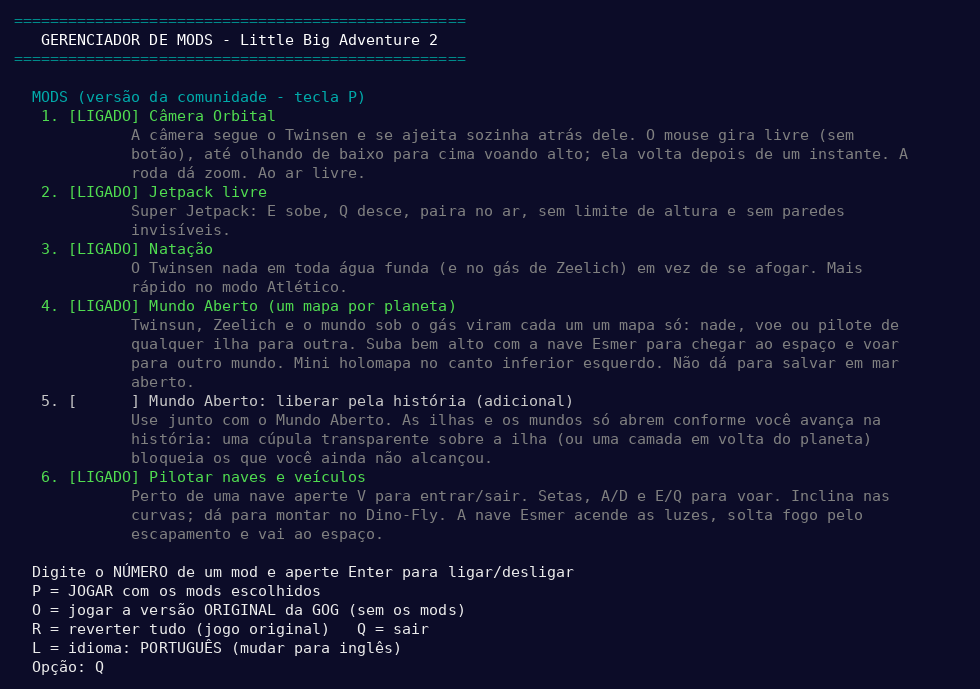

Ligar e desligar mods de jogabilidade é instantâneo. Se o jogo estiver aberto, feche e abra de novo com **P** para a mudança valer.

### Controles

| Mod | Controles |
|---|---|
| Pilotar naves | **V** perto do veículo = entrar/sair · **setas** = frente/trás e virar · **A/D** = de lado · **E/Q** = subir/descer (naves e Dino-Fly) · segurar frente 2 s = turbo |
| Espaço | suba bem alto com a nave Esmer · **setas** = virar · **E/Q** = nariz para cima/baixo · frente = acelerar |
| Câmera Orbital | **mouse** = olhar em volta · **roda** = zoom · **Enter** = câmera atrás do Twinsen |
| Jetpack livre | com o Super Jetpack: **E** sobe, **Q** desce |
| Mini holomapa | **F12**, digite `minimap` + Enter para esconder/mostrar |

### Bom saber
- **Saves:** a versão com os mods guarda os saves numa pasta própria do Windows, separados dos saves da GOG. Não dá para salvar em mar aberto.
- **Controle Inteligente de Aplicativos do Windows (Smart App Control):** ele pode bloquear o programa dos mods (`lba2cc.exe`), porque não tem assinatura digital de empresa. O gerenciador mostra como liberar: *Segurança do Windows → Controle de aplicativos e do navegador → Controle Inteligente de Aplicativos → Desativado*. A tecla **O** continua abrindo o jogo original.
- **Desinstalar:** abra o gerenciador, aperte **R** e depois apague a pasta `Mods`.

### Criar seus próprios mods
Uma pasta dentro de `Mods` com um `mod.ini`:

```ini
nome = My mod
descricao = What it does
nome_pt = Meu mod
descricao_pt = O que ele faz
autor = Seu nome
versao = 1.0
```

Opcionalmente, ela também pode ter:
- `textos.txt`: troca textos e diálogos;
- `hqr\ARQUIVO.HQR\N.bin`: troca a entrada N de um arquivo do jogo;
- `arquivos\...`: copia arquivos inteiros para a pasta do jogo.

Detalhes no `Mods\LEIA-ME.txt`.

### Como funciona por dentro
- Os mods de jogabilidade rodam numa versão modificada da **[LBA2 Classic Community](https://github.com/2point21/lba2-classic-community)**, um motor de código aberto do LBA2 (GPL-2.0).
- Todas as mudanças estão em [`engine/mods_motor.patch`](engine/mods_motor.patch), aplicado sobre o commit `2fa1c7a` daquele projeto.
- Para compilar você mesmo, veja [`engine/COMPILAR.md`](engine/COMPILAR.md).

### Créditos e licença
- **Mods:** Ricardo, com a ajuda do Claude (Anthropic).
- **Motor:** [LBA2 Classic Community](https://github.com/2point21/lba2-classic-community) e seus colaboradores.
- *Little Big Adventure 2* é © Adeline Software International / [2.21]. Este é um projeto de fã, sem fins lucrativos e sem ligação com os donos do jogo. É preciso ter uma cópia original.
- O código deste pacote (mudanças no motor, gerenciador e mods) é distribuído sob a **GPL-2.0**, a mesma licença do motor. Veja [`LICENSE`](LICENSE).

---

## English

A mod pack for **Little Big Adventure 2 (Twinsen's Odyssey)**. It turns the 1997 game into an open world: swim, fly and pilot from island to island with no loading screens, climb into space with the ship and travel between Twinsun, the Emerald Moon and Zeelich.

Everything comes with a simple **Mod Manager**, in English and Portuguese, to turn each mod on or off.

> You need the original game (tested on the **GOG** release, *Little Big Adventure 2 Classic*). This pack **ships no game files**: images, sounds and texts are read from your own copy while you play.

### What's new

#### Open World: one map per planet
- Each planet's islands become **one continuous map**: Twinsun's islands, Zeelich's islands and the islands of the under-gas world.
- Keep going past the edge of an island, swimming, with the jetpack or piloting, and you reach the **open sea** and the other islands, with no loading screen between sea areas.
- **Mini holomap** in the corner, in the inventory's style. It shows where Twinsen is and the **place name** ("Citadel Island", "Open sea"…).
- **Longer view distance**: coastlines and islands show up from farther away.

#### Space: travel between worlds
- Climb very high with the **Esmer ship** and you enter a **space scene built from scratch**, with a starry sky and Twinsun's two suns.
- The three worlds are spheres drawn with **the game's own holomap planet images**.
- Fly to one: when you get close, the game loads the island nearest to where you arrived and you fly down onto it.
- No engine noise in space (it's a vacuum), and the Emerald Moon's music plays.

#### Pilot ships and vehicles
- Walk up to **any ship or vehicle** and press **V** to get in: Esmer ship, Otringal taxi, ferry, balloon and even the **Dino-Fly**.
- **Ships** climb and dive (E/Q) and bank on turns. **Boats and the balloon** stay on the water, with **GTA-style** boat physics.
- **Details that bring it to life:**
  - the ship **retracts its landing gear** on takeoff and lowers it on landing;
  - **doors close** when you get in and open when you get out;
  - the **balloon's propeller** spins;
  - the ship switches on **the game's own lights** (the same ones as the ship leaving the Otringal base);
  - it **fires its exhaust** when you accelerate, like in the game's video;
  - hovering, the ship **floats** gently up and down.
- **Sounds:** takeoff, landing and the boats' engines are the game's own. The ship's flight sound is taken **from the original game video** while you play. The Dino-Fly flaps its wings and has a ceiling.

#### Orbital Camera (GTA style)
- The camera follows Twinsen and **settles behind him by itself**.
- The **mouse turns it freely**, with no button, and it comes back after a moment. The wheel zooms.
- When flying high you can look **up from below**.

#### Swimming
- Twinsen **swims** in all deep water, even in **Zeelich's gas**, instead of drowning. He swims faster in Athletic mode.

#### Free jetpack
- With the Super Jetpack: **E** goes up and **Q** goes down. He hovers, with no height limit and no invisible walls.

#### Open World: unlock by story (optional add-on)
- For an open world **without skipping the story**: islands and planets open up as you progress.
- An island you haven't reached yet sits under a **translucent dome**. It shows up when you get close, with the message **"Advance the story to unlock"**, and won't let you through.
- In space, a locked planet is wrapped in a **white layer**, with the message in its middle.

#### Mod Manager
- Turns each mod on or off with **one number**.
- **English or Portuguese** (L key): switches the language of the manager, the descriptions, the texts the mods show in the game and the game itself.
- The mods run on the community version of the game: **the original files are not changed**, and the O key still opens the original GOG game.

### What's innovative
- **A 1997 game with a real open world.** Each planet's islands were stitched into one map, and the sea between them is crossed with no loading screen.
- **A space layer built from scratch.** It uses the original holomap textures to draw the planets as spheres and links the three worlds through flight.
- **Only the game's own files.** The pack redistributes nothing from the game:
  - the ship's flight sound comes from the original video;
  - the ship's lights are the original model's;
  - island names come from the holomap texts, in the game's language.
- **Everything is optional.** Each mod switches on and off on its own, and the original GOG game stays untouched and playable (O key).

### Gallery
See the [Portuguese gallery above](#galeria). The screenshots are in [`docs/screenshots`](docs/screenshots).

### Requirements
- Windows 10 or 11, 64-bit.
- The original *Little Big Adventure 2*. Tested on the **GOG** release (*Little Big Adventure 2 Classic*). Other releases with the same `Common` folder should work but are untested.

### Download
1. Go to **[Releases](../../releases)** on this GitHub page.
2. Download **`LBA2-Twinsen-Mods-vX.Y.zip`** from the latest version. Don't use "Source code": it doesn't include the game program.

### Install
1. Open the game folder: the one that contains the **`Common`** folder and `TLBA2C.exe`. On GOG, for example:
   `C:\Program Files\GOG Galaxy\Games\tlba2-classic`
   In GOG Galaxy: click the game → settings button next to "Play" → **Manage installation → Show folder**.
2. Extract the zip **into that folder**. A **`Mods`** folder appears next to `Common`.
3. Done. Nothing else to install.

### Using the Mod Manager
1. Double-click **`Mods\LBA2 Mod Manager.bat`**.
   Windows asks for administrator permission, because the game is in "Program Files". Click **Yes**.
2. Type a mod's **number** and press **Enter** to turn it on or off.
3. The other keys:

| Key | What it does |
|---|---|
| **P** | Play with the chosen mods (starts the community version, which runs the gameplay mods) |
| **O** | Starts the **original** GOG game, without the mods |
| **R** | Turns all mods off |
| **L** | Switches language: English ↔ Portuguese |
| **Q** | Quit |

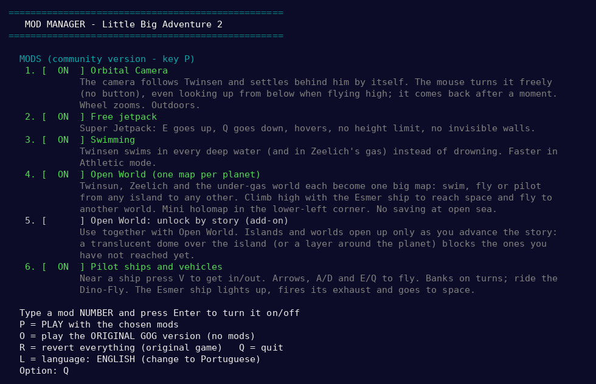

Turning gameplay mods on or off is instant. If the game is open, close it and start it again with **P** for the change to apply.

### Controls

| Mod | Controls |
|---|---|
| Pilot ships | **V** near a vehicle = get in/out · **arrows** = forward/back and turn · **A/D** = sideways · **E/Q** = up/down (ships and Dino-Fly) · hold forward 2 s = turbo |
| Space | climb very high with the Esmer ship · **arrows** = turn · **E/Q** = nose up/down · forward = accelerate |
| Orbital Camera | **mouse** = look around · **wheel** = zoom · **Enter** = camera behind Twinsen |
| Free jetpack | with the Super Jetpack: **E** up, **Q** down |
| Mini holomap | **F12**, type `minimap` + Enter to hide/show |

### Good to know
- **Saves:** the modded version keeps its saves in its own Windows folder, separate from the GOG saves. You can't save at open sea.
- **Windows Smart App Control:** it may block the mods' program (`lba2cc.exe`), because it isn't digitally signed by a company. The manager explains how to allow it: *Windows Security → App & browser control → Smart App Control → Off*. The **O** key still starts the original game.
- **Uninstall:** open the manager, press **R**, then delete the `Mods` folder.

### Make your own mods
A folder inside `Mods` with a `mod.ini`:

```ini
nome = My mod
descricao = What it does
nome_pt = Meu mod
descricao_pt = O que ele faz
autor = Your name
versao = 1.0
```

Optionally, it can also have:
- `textos.txt`: changes texts and dialogues;
- `hqr\FILE.HQR\N.bin`: replaces entry N of a game file;
- `arquivos\...`: copies whole files into the game folder.

Details in `Mods\README.txt`.

### Under the hood
- The gameplay mods run on a modified build of **[LBA2 Classic Community](https://github.com/2point21/lba2-classic-community)**, an open-source LBA2 engine (GPL-2.0).
- All changes are in [`engine/mods_motor.patch`](engine/mods_motor.patch), applied on top of that project's commit `2fa1c7a`.
- To build it yourself, see [`engine/COMPILAR.md`](engine/COMPILAR.md).

### Credits and license
- **Mods:** Ricardo, with help from Claude (Anthropic).
- **Engine:** [LBA2 Classic Community](https://github.com/2point21/lba2-classic-community) and its contributors.
- *Little Big Adventure 2* is © Adeline Software International / [2.21]. This is a non-profit fan project with no ties to the game's owners. You need an original copy.
- The code in this pack (engine changes, manager and mods) is released under the **GPL-2.0**, the same license as the engine. See [`LICENSE`](LICENSE).
